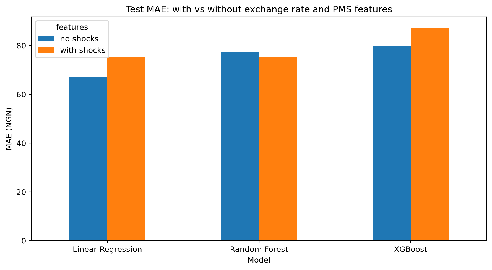

# Introduction, Model Comparison, Conclusion and Recommendations

*Olukayode Ogunmoroti (Group Leader)*

## 1. Introduction

In 2023 Nigeria went through two major economic shocks within weeks of each other: the removal of the fuel subsidy in May 2023 and the float of the naira in June 2023. Petrol prices and the value of the naira both changed sharply, and food prices rose with them. Households spend a large share of their income on staple foods, so understanding how quickly and how strongly these prices moved matters for food security.

This project looks at two questions:

1. **What happened?** How did the prices of staple foods change around the fuel subsidy removal and the naira float, and did the change differ by commodity and by state?
2. **Can the shocks help predict food prices?** If we predict next month's food price from last month's information, does adding the exchange rate and the petrol (PMS) price make the prediction better than using past food prices alone?

To keep the project achievable, we limited its scope following our supervisor's feedback. We studied **six markets in the North East**, three in Borno State (Monday in Maiduguri, Abba Gamaram, Budum) and three in Yobe State (Gujba (Buni Yadi), Potiskum, Bade (Gashua)), and **six staple commodities**: local rice, millet, sorghum, yam, white beans and maize flour. We focused on the North East because the WFP price records for most other states stop in January 2023, before the shocks, so they could not show what happened afterwards.

We used three data sources: WFP retail food prices (converted to naira per kilogram), the CBN daily US dollar exchange rate (averaged by month), and the NBS monthly petrol (PMS) price reports. The descriptive analysis uses food prices from April 2022. The prediction models use monthly data from March 2023 to May 2026 (39 months), which is the period where all three sources are available.

The rest of this report describes the data and methods, the descriptive results, the prediction models, and then our conclusions. This section and the final sections bring the two parts together.

## 2. Model Comparison Results

### 2.1 Set-up

We trained three regression models, Linear Regression, Random Forest and XGBoost, to predict the price of a commodity in a market for the current month from the previous months' information. Every model was trained twice:

- **Model A (with shock features):** last month's price, the price two months ago, month of the year, market and commodity indicators, **plus last month's exchange rate and last month's PMS price**.
- **Model B (without shock features):** the same, but without the exchange rate and PMS price.

We split the data by time, not at random. The models were trained on March 2023 to September 2025 (897 observations) and tested on the most recent eight months, October 2025 to May 2026 (282 observations, 138 from Borno and 144 from Yobe). This way the models are always tested on months they have not seen. We also added a **naive benchmark**, which simply predicts that this month's price equals last month's price. A model is only useful if it can match or beat this simple rule. Models were compared using MAE (average error in naira per kg), RMSE and R².

### 2.2 Results

| Model | Features | MAE (NGN/kg) | RMSE (NGN/kg) | R² |
|---|---|---|---|---|
| Naive (this month = last month) | Last month's price only | 66.9 | 103.9 | 0.889 |
| Linear Regression | With shocks (A) | 75.4 | 105.3 | 0.886 |
| Linear Regression | Without shocks (B) | 67.1 | 98.8 | 0.900 |
| Random Forest | With shocks (A) | 75.2 | 109.8 | 0.876 |
| Random Forest | Without shocks (B) | 77.4 | 111.2 | 0.873 |
| XGBoost | With shocks (A) | 87.3 | 122.6 | 0.846 |
| XGBoost | Without shocks (B) | 79.9 | 120.3 | 0.851 |

### 2.3 What the results show

**1. Adding the exchange rate and PMS price did not consistently improve predictions.** For Linear Regression, the model with shock features was worse (MAE 75.4 against 67.1). For XGBoost it was also worse (87.3 against 79.9). Only Random Forest improved slightly with the shock features (75.2 against 77.4), and the gain of about 2 naira per kg is small compared with the losses in the other two models.

**2. Past food prices carry almost all of the useful information.** The best model overall was Linear Regression without the shock features. It had the lowest RMSE (98.8) and the highest R² (0.900), but its MAE (67.1) was practically the same as the naive benchmark (66.9). The two tree-based models did not beat the naive benchmark on MAE in either version. In plain terms, "next month's price will be close to this month's price" is very hard to improve on with this data.

**3. The errors are modest in relative terms.** The average test price across the six commodities was about 690 naira per kg, so an MAE of about 67 is roughly 10% of the typical price. Errors were largest for the expensive items. Using the naive rule, the average error was about 108 naira per kg for white beans and 85 for yam, but only about 28 to 32 for millet and sorghum.

### 2.4 Possible reasons

We did not test these explanations, so they should be read as possibilities and not as findings:

- **Little new information.** The exchange rate and PMS price are national figures. Every market and commodity shares the same value in a given month, so across the 39 months they supply only 39 distinct values, which makes it easy for a model to latch onto patterns that do not hold later. Last month's food price already contains much of the effect of earlier fuel and exchange rate movements.
- **Trend and range problems.** Both variables rose strongly over the period. The PMS price in the test months went as high as about 1,533 naira per litre, above the highest value in the training months (about 1,262). Tree-based models (Random Forest and XGBoost) cannot predict beyond the range they were trained on, which may explain why they did not benefit.
- **Timing.** We used only a one-month lag. The effect of fuel and exchange rate changes on food prices may take longer to appear.
- **Small test set.** The test period is only eight months, from a single split, so small differences between models (for example the gain for Random Forest) should not be over-interpreted.

## 3. Conclusion

**What happened to food prices.** In our six North East markets, staple food prices rose clearly around the two shocks. Using 3-month windows before and after each event, yam, maize flour, sorghum and millet rose by roughly 29% to 36% around the fuel subsidy removal, and by roughly 39% to 69% around the naira float. Local rice rose the least (about 9% and 12%). The increases were larger in Yobe than in Borno around the subsidy removal. By March to May 2026, the average prices were about 4.3 times higher for yam, 2.8 times for maize flour and about 1.4 to 2.2 times for the other commodities compared with February to April 2023. The two events were only weeks apart, so we describe what happened around them and do not claim to separate the effect of one from the other. The descriptive section gives the full tables and charts.

**Whether the shocks help predict prices.** In our data, they did not help reliably. Models that used last month's exchange rate and PMS price were not consistently better than models that used past food prices alone, and none of the models clearly outperformed the naive "same as last month" rule on average error. This does not mean fuel and exchange rate movements have no effect on food prices. Our results are more limited: once last month's food price is known, adding last month's national exchange rate and petrol price gave no dependable improvement in predicting next month's price in these markets.

**Limits of the work.** Our results apply to six markets in two North East states and six commodities, so they should not be generalised to the whole country. The test period is short. The WFP data has gaps (for example, the Borno markets have no records from February to August 2024), and the PMS value for May 2023 (N238.11 per litre) was taken from the NBS May 2024 report because that month was not in the reports we downloaded. Our models describe association and prediction, not cause.

## 4. Recommendations

1. **For anyone forecasting food prices in these markets:** start with last month's price as the main predictor. It is hard to beat, and the extra complexity of using national exchange rate and fuel data did not pay off in our test.
2. **For monitoring and support:** the largest and fastest increases were in yam, maize flour and sorghum, and in Yobe around the subsidy removal. Price monitoring and any food support should give these items and areas priority.
3. **For data collection:** price records for most Nigerian states stop in January 2023 in the WFP dataset. Continued, consistent market price collection across all zones, with stable units and fewer gaps, would make this kind of analysis possible for the whole country.
4. **For future model comparisons:** judge models against a simple benchmark such as the naive rule, and test them on later months only, so that results show how the model would work on genuinely new data.

## 5. Future Work

The following were outside the scope of this project and would make good extensions:

- **Wider coverage:** other geopolitical zones (for example Lagos, Kano, Enugu and Port Harcourt), using price sources that cover them after 2023, such as FEWS NET, with more commodities and weekly data.
- **Other drivers of food prices:** conflict data (ACLED), rainfall data (CHIRPS or NASA POWER), and inflation/CPI, to separate the effect of the fuel and exchange rate shocks from insecurity and weather.
- **Structural break tests:** to check statistically which events created real breaks in the price series.
- **Time-series and panel econometric methods:** to measure how long the effects take to appear and fade, and to separate the shocks from other factors.
- **Better shock variables and timing:** longer lags (two to three months), state-level petrol prices for Borno and Yobe instead of the national average, and the parallel-market exchange rate.
- **Stronger testing of models:** rolling-window validation across several test periods, and proper tuning of the Random Forest and XGBoost settings, with a longer data history.
